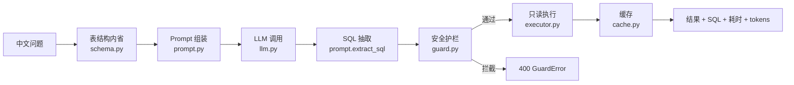

# AI SQL Analyst · 自然语言查数助手

把中文业务问题翻译成一条 SQL，在**只读连接**上执行，并把结果、SQL、耗时和 token 消耗一起返回。

支持 `python -m nl2sql ask "订单量最多的 5 个城市"` 直接提问，也提供 FastAPI HTTP 接口。

```
问题 → 表结构内省 → Prompt 组装 → LLM → SQL 抽取 → 安全护栏 → 只读执行 → 缓存
```

## 为什么做这个

临时取数需求又碎又急，写 SQL 的时间往往比分析本身还长。但把大模型直接接到生产库上是危险的：
模型会编造表名、会漏掉 `WHERE`、甚至可能输出写操作。

这个项目想验证一件事：**LLM 生成的 SQL 可以被安全执行**——前提是把「只读」做成三层硬约束
（词法护栏、只读连接、超时熔断），而不是靠提示词祈祷。

## 特性

- **一句话查数**：中文问题 → SQL → 结果表，CLI 与 HTTP 双入口
- **三层安全边界**：只放行单条 `SELECT`/`WITH`、`mode=ro` 只读连接、慢查询超时中断
- **行数兜底**：缺 `LIMIT` 时自动追加（单行聚合除外），截断结果显式标记
- **省钱缓存**：TTL + LRU，键绑定表结构指纹与模型名，命中即不再调用大模型
- **离线可玩**：没有 API Key 时自动切到内置规则模型，全链路照样跑通
- **零依赖核心**：业务逻辑只用标准库；FastAPI 只在 Web 层需要
- **测试覆盖**：64 个单元测试，CI 跑 Python 3.10 / 3.12

## 架构



模块职责（`src/nl2sql/`）：

| 模块 | 职责 |
| --- | --- |
| `schema.py` | 读取表结构，渲染成紧凑 DDL，计算结构指纹 |
| `prompt.py` | System Prompt + few-shot + 本次问题；从模型回复里抽 SQL |
| `llm.py` | OpenAI 兼容的 HTTP 客户端（重试、超时、token 统计）；`FakeLLM` 离线替身 |
| `guard.py` | 词法级白名单校验，必要时补 `LIMIT` |
| `executor.py` | `mode=ro` 连接执行，`fetchmany(max_rows+1)` 判断截断，超时中断 |
| `cache.py` | 线程安全 TTL + LRU，统计命中率 |
| `service.py` | 串起上面所有步骤，定义 `Answer` 结构与错误分类 |
| `cli.py` | `ask` / `schema` 两个子命令 |

## 快速开始

### 本地

```bash
git clone https://github.com/wuhuhuhu123123-code/ai-sql-analyst.git
cd ai-sql-analyst

python scripts/seed_db.py --out data/ecommerce.db   # 生成演示库（4 张表、1200 单）
pip install -e .                                     # 装 Web 层依赖

# 有 API Key 时用真实模型
export LLM_API_KEY=sk-xxx
python -m nl2sql ask "2025 年各品类的销售额排名"

# 没有 Key 也能跑
python -m nl2sql ask "2025 年各品类的销售额排名" --offline
```

> 核心逻辑与测试**不需要任何第三方包**，只有 `uvicorn` 起 Web 服务时才要 `pip install -e .`。

### Docker

```bash
docker compose up --build
# 打开 http://127.0.0.1:8000/docs
```

镜像内已自带演示数据库，不需要外网也能查询（`LLM_API_KEY` 留空即离线模式）。

## 命令行演示

以下输出均为仓库内置演示库的真实运行结果（`--offline` 模式，模型部分由内置规则替代）：

```console
$ python -m nl2sql ask "2025 年各品类的销售额排名" --offline
问题：2025 年各品类的销售额排名
SQL ：
SELECT p.category AS 品类,
       ROUND(SUM(oi.quantity * oi.unit_price), 2) AS 销售额
FROM order_items oi
JOIN orders o ON o.order_id = oi.order_id
JOIN products p ON p.product_id = oi.product_id
WHERE o.status = '已完成'
GROUP BY p.category
ORDER BY 销售额 DESC
LIMIT 10

品类    销售额
--------------
家用电器  223857.4
数码配件  170381.6
运动户外  124151.3
食品饮料  55263.0
家居日用  43891.4

行数 5 ｜ 耗时 3.8ms ｜ 缓存 未命中 ｜ tokens 976 ｜ 模型 fake-rule-model
```

```console
$ python -m nl2sql ask "订单量最多的 5 个城市" --offline
城市  订单量
-------
长沙  184
杭州  172
武汉  158
广州  158
厦门  156
```

`python -m nl2sql schema` 会打印渲染进提示词的 DDL 与结构指纹，方便排查「模型为什么认错了列」。

## HTTP 接口

| 方法 | 路径 | 说明 |
| --- | --- | --- |
| GET | `/healthz` | 健康检查，返回模型与离线状态 |
| GET | `/api/schema` | 表结构、行数、字段类型、结构指纹 |
| POST | `/api/query` | 自然语言查询 |
| GET | `/api/cache` | 缓存命中率、容量、淘汰次数 |

```bash
curl -X POST http://127.0.0.1:8000/api/query \
  -H "Content-Type: application/json" \
  -d '{"question": "订单量最多的 5 个城市"}'
```

下面是离线模式下的真实响应（`rows` 完整保留）：

```json
{
  "question": "订单量最多的 5 个城市",
  "sql": "SELECT c.city AS 城市,\n       COUNT(DISTINCT o.order_id) AS 订单量\nFROM orders o\nJOIN customers c ON c.customer_id = o.customer_id\nGROUP BY c.city\nORDER BY 订单量 DESC\nLIMIT 5",
  "columns": ["城市", "订单量"],
  "rows": [
    {"城市": "长沙", "订单量": 184},
    {"城市": "杭州", "订单量": 172},
    {"城市": "武汉", "订单量": 158},
    {"城市": "广州", "订单量": 158},
    {"城市": "厦门", "订单量": 156}
  ],
  "row_count": 5,
  "truncated": false,
  "cached": false,
  "model": "fake-rule-model",
  "latency_ms": 2.42,
  "tokens": {"prompt": 844, "completion": 83, "total": 927},
  "warnings": []
}
```

换成真实模型后 `model` 会变成 `deepseek-chat` 之类，`latency_ms` 通常在 600~1500ms，
`tokens` 由上游返回的真实用量填充。

接口层可以用仓库自带的脚本做一次端到端冒烟（需要装 Web 层依赖）：

```bash
python scripts/smoke_http.py
```

它会依次验证 `/healthz`、`/api/schema`、`/api/query`、缓存命中、`/api/cache`、
以及空问题返回 `422`，全部通过才打印「冒烟测试通过」。

## 安全设计

模型输出被当作**不可信输入**，执行前必须过三道关：

1. **词法护栏**（`guard.py`）
   - 必须以 `SELECT` / `WITH` 开头；拒绝多语句、注释、`PRAGMA`、`sqlite_master`
   - 拒绝 `INSERT/UPDATE/DELETE/DROP/ALTER/ATTACH` 等关键字
   - 缺 `LIMIT` 自动补上限；单行聚合不补
2. **只读连接**（`executor.py`）
   - `file:...?mode=ro` 打开，即使护栏被绕过也写不进去
   - `PRAGMA` 之外不暴露任何连接句柄
3. **资源熔断**
   - `set_progress_handler` 每 1000 条 VM 指令检查一次，超过 3 秒中断
   - `fetchmany(max_rows + 1)`：最多取 200 行，多取的一行只用来判断「是否被截断」

失败按类型分流：护栏拦截 → `400`，SQL 执行失败 → `422`，模型调用失败 → `502`。

## 缓存与成本

- 缓存键 = `sha256(规范化问题 + 表结构指纹 + 模型名)`，换库表或换模型自动失效
- 默认 TTL 600s、容量 256 条，LRU 淘汰
- 只缓存「可复现的答案」：`cached`、`latency_ms` 属于调用现场信息，不从缓存里还原
- 提示词里只注入 4 张表的紧凑 DDL + 3 条 few-shot，单次调用约 600~1000 prompt tokens

## 测试

```bash
# 核心逻辑（零依赖）
python -m unittest discover -s tests -t tests -v

# 只跑护栏测试
python -m unittest tests.test_guard -v
```

覆盖重点：

- `test_guard.py` — 多语句、注释绕过、写操作、`REPLACE()` 误杀回归、聚合不补 LIMIT
- `test_executor.py` — 只读连接拒绝写、截断标记、错误分类
- `test_service.py` — FakeLLM 驱动的端到端链路：命中缓存不重复调用、护栏拦截、截断提示
- `test_cache.py` — 过期、LRU 淘汰、命中率统计、键的稳定性
- `test_prompt.py` — few-shot 注入、围栏/前缀剥离、分号截断

## 目录结构

```
ai-sql-analyst/
├─ app/                  # FastAPI 适配层（路由很薄）
│  ├─ main.py
│  └─ models.py
├─ src/nl2sql/           # 核心逻辑（零第三方依赖）
├─ scripts/seed_db.py    # 生成演示电商库
├─ tests/                # 64 个 unittest 用例
├─ docs/AI_WORKFLOW.md   # AI 辅助开发的真实分工与踩坑
├─ Dockerfile / docker-compose.yml
└─ .github/workflows/ci.yml
```

## 已知限制

- 只支持 SQLite；生产换 MySQL 需要重写 `executor.py` 与 `schema.py`
- 护栏是词法级而非 AST 级，极端写法（如字符串里含 `--`）会被误杀，宁严勿松
- 单轮问答，没有多轮追问与列名澄清
- `--offline` 的规则模型只认 5 类关键词，仅用于演示，不代表真实效果

## Roadmap

- [ ] 用 `sqlglot` 做 AST 级校验，替换正则护栏
- [ ] 失败重试：SQL 报错时把错误信息回灌给模型，让它自我修正（一次）
- [ ] 结果转自然语言摘要（可选，另一次调用）
- [ ] 支持 MySQL / PostgreSQL 方言

## AI 辅助开发

这个项目全程使用 AI 编程工具（Claude Code 这类命令行 Agent）参与，但安全边界、数据口径、性能数字全部由人把关。
具体分工与三个真实踩坑见 [docs/AI_WORKFLOW.md](docs/AI_WORKFLOW.md)。

## License

[MIT](LICENSE)
